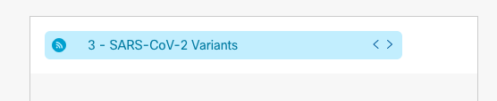

# WCC Widget Starter: RSS feed
## Development

Setting up your development environment:

1. Clone this repo
2. Run `yarn` from the root of the repo.
3. Run `yarn start` to start the playground app.

To use the RSS Feed Widget, add a URL src link to an XML RSS feed in the 'rss-feed' attribute.

## Iframe shell / header placement

This widget is a **compact ticker** (one item + arrows). Keep it that way in `advancedHeader` / `header.*` — the host iframe is only ~48–64px tall. Do not open article lists, menus, or `md-menu-overlay` from the header; those clip. For a full feed list, put `rss-feed-widget` in `navigation` or `panel`.

This is not a host-iframe-shell demo. Partner overlay / SDK / sibling-bus fixes live in [`../iframe-shell/`](../iframe-shell/).

