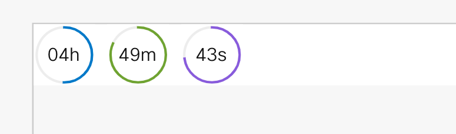

# WCC Widget: Timer

Testing in development environment:

1. Clone this repo
2. Run `yarn` from the root of the repo.
3. Run `yarn start` to start the playground app.

To use the Timer Widget:

1. Pass a time to the `duration` attribute following the string format: "hh:mm:ss".
2. Toggle the boolean attribute `paused` to stop and start the timer.

The timer stays **compact** so it can sit in `advancedHeader` without opening a panel. Do not add settings menus that overflow the ~48–64px header iframe; use `Desktop.popover` if you need a larger panel (see [`../iframe-shell/`](../iframe-shell/)).

Storage keys are scoped as `timer-widget:start` and `timer-widget:duration`. In the iframe shell, `localStorage` is origin-isolated and often in-memory — it is not shared with sibling widgets. To change duration, call `resetTimer():void`.

Timer is set to a default of "08:00:00"

When the timer reaches "00:00:00" it pauses, clears storage, posts `{ type: "WXCC_WIDGET_EVENT", event: "timer-expired" }` on `window` (the host relays this to sibling iframes), and still dispatches a bubbling `timer-expired` CustomEvent for same-document listeners. After changing this source, run `yarn build` from `Examples/` to refresh `widgets/timer.js`. 

